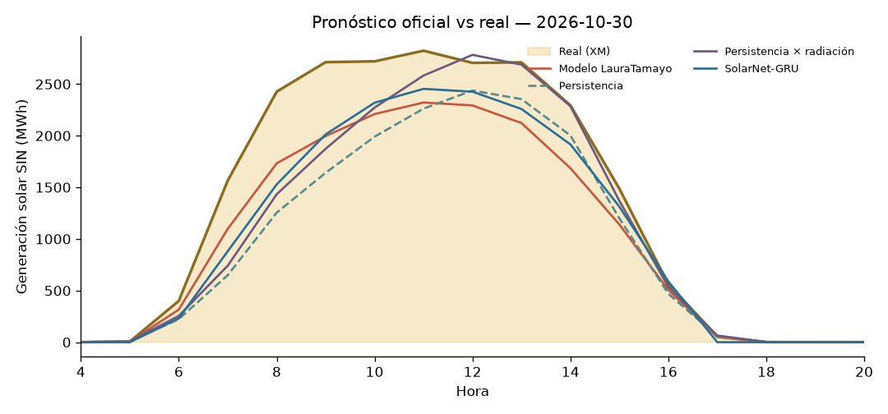
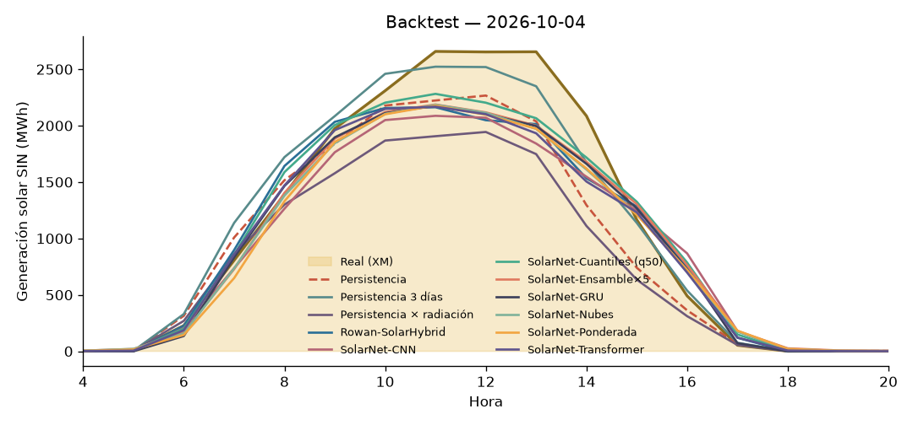

# ☀️ Liga de Pronóstico Solar Colombia — Leaderboard

_Actualizado: 2026-11-06 13:38 (hora Colombia) · Métrica: MAE en horas de sol (06–18 h) · Skill = 1 − MAE/MAE_persistencia (positivo = le ganas a la persistencia)_

## 🏆 Liga oficial (predicciones hechas ANTES de conocer el dato real)

| # | Modelo | Autor | Días | MAE (MWh) | nMAE | Skill vs persistencia |
|---|---|---|---|---|---|---|
| 🥇 | Rowan-SolarHybrid | rowanvrock96 | 27 | 207.0 | 14.2% | +27.4% |
| 🥈 | SolarNet-Cuantiles (q50) | profe (reto 6) | 28 | 208.4 | 14.4% | +24.5% |
| 🥉 | SolarNet-Ensamble×5 | profe (reto 5) | 28 | 213.0 | 14.7% | +22.9% |
| 4 | SolarNet-Nubes | profe (reto 2) | 28 | 213.1 | 14.7% | +22.6% |
| 5 | SolarNet-GRU | profe | 28 | 215.2 | 14.8% | +21.8% |
| 6 | SolarNet-Ponderada | profe (reto 3) | 28 | 218.9 | 15.1% | +20.1% |
| 7 | SolarNet-Transformer | profe (reto 4) | 28 | 220.6 | 15.2% | +19.5% |
| 8 | SolarNet-CNN | profe (reto 4) | 28 | 225.3 | 15.5% | +18.3% |
| 9 | Persistencia × radiación | profe | 28 | 254.6 | 17.5% | +10.2% |
| 10 | Persistencia 3 días | profe (reto 1) | 28 | 281.4 | 19.4% | -0.6% |
| 11 | Persistencia | profe | 28 | 328.2 | 22.6% | — |

## 🧪 Backtest (días pasados, para arrancar en frío)

_Ojo: en el backtest el 'pronóstico' de clima es casi el clima observado → resultados optimistas._

| # | Modelo | Autor | Días | MAE (MWh) | nMAE | Skill vs persistencia |
|---|---|---|---|---|---|---|
| 🥇 | SolarNet-GRU | profe | 14 | 170.4 | 11.8% | +34.8% |
| 🥈 | Rowan-SolarHybrid | rowanvrock96 | 14 | 171.9 | 11.9% | +33.3% |
| 🥉 | SolarNet-Cuantiles (q50) | profe (reto 6) | 14 | 183.3 | 12.7% | +32.4% |
| 4 | SolarNet-Nubes | profe (reto 2) | 14 | 187.4 | 13.0% | +30.5% |
| 5 | SolarNet-Ensamble×5 | profe (reto 5) | 14 | 193.8 | 13.4% | +27.6% |
| 6 | SolarNet-CNN | profe (reto 4) | 14 | 195.2 | 13.5% | +30.9% |
| 7 | SolarNet-Transformer | profe (reto 4) | 14 | 196.4 | 13.6% | +26.5% |
| 8 | SolarNet-Ponderada | profe (reto 3) | 14 | 212.5 | 14.7% | +23.6% |
| 9 | Persistencia × radiación | profe | 14 | 244.8 | 17.0% | +13.4% |
| 10 | Persistencia 3 días | profe (reto 1) | 14 | 298.8 | 20.7% | +10.6% |
| 11 | Persistencia | profe | 14 | 334.8 | 23.2% | — |

